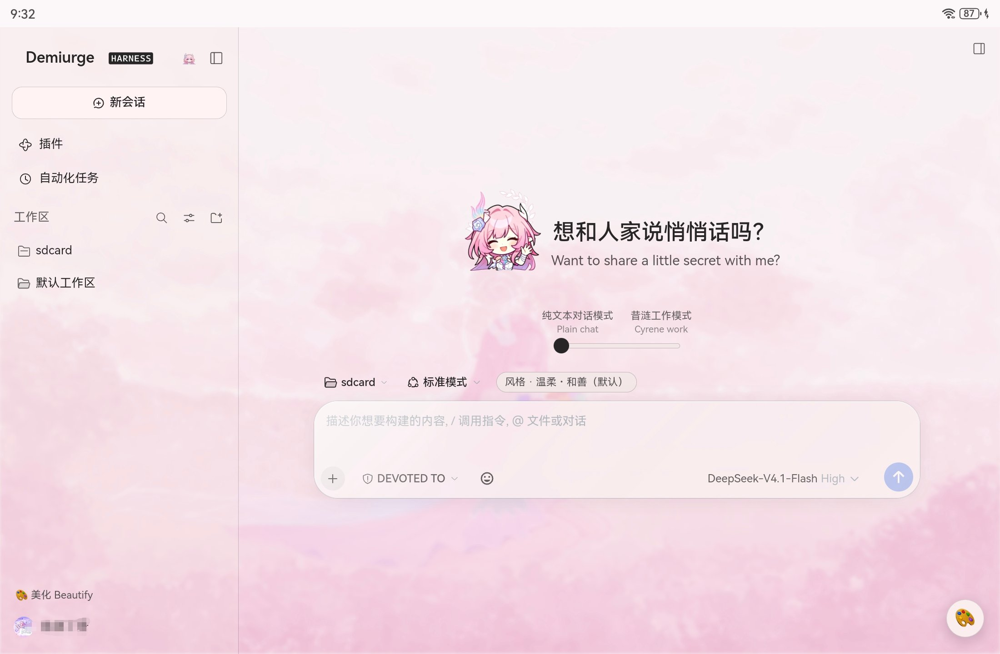

# DSH-Cyrene-UI

为 [DeepSeek Harness](https://github.com/deepseek-ai) 的 Web 界面做的一套**轻量美化插件**：
换掉侧栏品牌字、重做新会话页的标题与吉祥物、把输入框提示和若干界面文案变成可自定义的。

它是 [dsh-cyrene](https://github.com/Cyrene-xl/DSH-Cyrene)（昔涟人设插件）的配套界面层，
但**两个仓库各自独立**：不装 dsh-cyrene 也能用，只是「称呼偏好」变量与 Hero 里的
风格入口会自然失效。



## 它改了什么

**brand-rename**

- 侧栏左上角：去掉「deepseek」左侧的鲸鱼图标，品牌字换成可自定义的名字（默认 `Demiurge`），
  右侧 `HARNESS` 徽标逐像素保留；
- 新会话 Hero 标题：最多 10 条，可随机或按顺序轮换；每条可配一行英文副标题；
  中英文标题都能调字号 / 上下 / 左右；新增「锁定大小与位置」防误触；调整时设置面板半透明；
- 输入框灰色提示：按会话状态（空白 / 进行中 / 中断…）逐条自定义，中文一行、英文可另起一行；
- 侧栏「设置 / 美化」与底栏「轮 / 步 / 缓存命中」可加英文；三个权限预设可改名，
  确认弹窗里的旧名字同步替换；
- 设置 → 通用里可改「称呼」—— 注册为提示词变量 `{{user_nickname}}`，下一轮生效。

**hero-mascot**

- 新会话页左侧吉祥物：默认图随包发运，也可在设置里上传自己的图；
- 上传时可选「抠白底」（从四边泛洪，只吃连通背景）；
- 大小 / 水平 / 垂直可调，并带「锁定位置与大小」；
- 图片与尺寸存浏览器 `localStorage`；换端口 / 换包名会丢（换机前记得重传）。

## 包含的插件

| 包 | 版本 | 作用 |
|---|---|---|
| [`packages/brand-rename`](./packages/brand-rename) | 1.16.3 | 品牌字 / 标题 / 输入框提示 / 侧栏英文 / 底栏单位 / 权限名 / 称呼 |
| [`packages/hero-mascot`](./packages/hero-mascot) | 2.2.0 | 新会话吉祥物：上传、抠白底、大小位置、锁定 |

## 安装

需要 **DSH 0.1.5 ~ 0.2.1**（0.2.1-rc.2 实测）、**Node 22+**。

```bash
git clone https://github.com/Cyrene-xl/DSH-Cyrene-UI.git
cd DSH-Cyrene-UI

dsh plugin --profile web add link:$PWD/packages/brand-rename
dsh plugin --profile web add link:$PWD/packages/hero-mascot
```

装完重启 DSH（或重开 App），设置 → 通用里会出现对应设置行。两个包可单独装、单独卸：

```bash
dsh plugin --profile web remove dsh-brand-rename
dsh plugin --profile web remove dsh-hero-mascot
```

## 兼容性与已知限制

- 界面层依赖 DSH 的客户端槽位与 DOM 结构，**升级 DSH 大版本后可能需要适配**；
  0.2.1 已针对 CSS Modules 类名变化做过一次修复（`_titleGroup` → `pXSMma_titleGroup` 等）；
- 吉祥物图片与 brand-rename 的部分编辑器设置存在浏览器 `localStorage`，
  按 origin（端口）隔离 —— 换端口后需要重传/重设；
- 不改对话内容、工具、权限与模型行为，只动界面文案与 Hero 区；
- 工作模式（带 shell/文件工具）下不显示 Hero 风格入口，这是刻意约定。

## 与 dsh-cyrene 的联动

- 「称呼偏好」会注册为 `{{user_nickname}}`（需要宿主有 `systemPrompt` 服务）；
  没有 dsh-cyrene 时这个变量无人使用，设置行仍可打开；
- Hero 的「表达风格」按钮依赖 `/cyrene-style-api`（由 dsh-cyrene 提供）；没有它时按钮自动隐藏；
- 两者共享同一套视觉语言，但不是依赖关系。

## 关联开源插件

下面这些**不随本仓库分发**，各自独立维护；按需安装、遵守各自许可：

| 插件 | 作用 | 仓库 | 许可 |
|---|---|---|---|
| `dsh-cyrene` | 昔涟人设、记忆、世界书、角色扮演 | <https://github.com/Cyrene-xl/DSH-Cyrene> | MIT |
| `dsh-dream-skin` | 皮肤 / 壁纸 / 面板透明度 | <https://github.com/RevolutionLA/dsh-dream-skin> | MIT |
| `dsh-meme` | 表情包图库与 `send_meme` | <https://github.com/yyh-001/dsh-meme> | MIT |
| `dsh-anime-theme` | 随机二次元壁纸（可选） | <https://github.com/zxr2115-1/dsh-anime-theme> | MIT |
| `dsh-ui-boost` | 主色调着色、Dock 等微调 | <https://github.com/DoshinJiu/dsh-ui-boost> | 仓库未声明 SPDX，使用前自行确认 |
| `dsh-effort-switcher` | 把推理强度选择换成滑杆 | <https://github.com/lemonorangeapple/dsh-effort-switcher> | 仓库未声明 SPDX |
| `dsh-custom-splash` | 自定义启动动画（视频 / CSS） | <https://github.com/diexianxiang/dsh-custom-splash> | 源码 LICENSE 为 MIT |
| `dsh-550c-boot` | 550C 片头 + UEG 授权界面 | <https://github.com/yannicksong0106/dsh-550c-boot>（npm 同名） | MIT |

> 两个启动动画插件都会往 `index.html` 注入首帧，**同时装会叠在一起**，只留一个。
> 界面类插件（dream-skin / ui-boost / anime-theme）可能与本仓库同时修改同一块 DOM，
> 出现样式互盖时优先检查它们的选择器。

## 开发与测试

两个包都是**零运行时依赖**，测试用 Node 内置 runner：

```bash
npm test          # 契约自检 + 两个包的全部测试
```

单独跑：

```bash
cd packages/brand-rename && node --test tests/*.mjs
cd packages/hero-mascot  && node --test tests/*.mjs
```

`scripts/check-contract.mjs` 会检查：`engines`、`exports` 是否都指向真实文件、
`files` 覆盖、无生命周期脚本、无运行时依赖。

## 许可与素材

- **代码**：MIT，见 [`LICENSE`](./LICENSE)；
- **吉祥物默认图**：角色「昔涟」版权归 HoYoverse / 米哈游，本仓库以非商用同人素材附带，
  **禁止商用**，详见 [`THIRD_PARTY_NOTICES.md`](./THIRD_PARTY_NOTICES.md)；
  可随时上传自己的图片替换。
- 本仓库**不包含**字体、图库或第三方插件源码。
